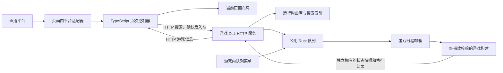

# 项目架构与扩展约定

本文是本仓库重构和后续扩展的约束。当前唯一支持的游戏是 **IIDX 33 / 20260812**；33 是大版本，20260812 是构建版本。没有 SDVX 或其他构建的可用实现。新增支持不得仅凭版本名称跳过二进制指纹和入口校验。

## 产品与运行模型

发布物是游戏 DLL、默认配置和独立静态网页。ZIP 只包含运行需要的文件；README、docs、AGENTS.md、LICENSE 和 THIRD-PARTY-NOTICES.md 保留在仓库。用户启动游戏、在 OBS 添加页面即可使用；不要求启动 Node、额外控制端或平台连接程序。Node/npm/Vite 仅用于开发和构建。



每套静态页面独立部署，可有不同布局、配置和平台接入；不要求各主播共用界面。多个主播选择复用同一页面时，用 URL 的 authCode 区分 Bilibili 连接，不配置主播 mapping，也不读 OBS 推流密钥。一个直播会话只支持一个活动点歌页面和一个游戏。不设计多页面选主、控制租约、多游戏路由或分布式事务。

DLL 的 bilimani-queue 是队列的唯一所有者，HTTP 与游戏内菜单操作同一份内存状态。页面刷新重新读取配置、重连平台并读取现有队列，不清空或恢复队列；游戏退出才清空队列。页面本地的候选、冷却和弹幕记录在刷新时清空。不重放结果不明的 POST。

## 仓库与依赖方向

```text
crates/
  bilimani-api/              # 通用 HTTP、静态资源、请求/错误协议
  bilimani-queue/            # 公用队列与纯状态转换，无平台/游戏内存依赖
  bilimani-menu/             # 精简队列菜单、Spice D3D9 渲染，无直播配置
  bilimani-iidx/             # 一个游戏一个 crate，生成 IIDX DLL
    src/
      versions/v33/b20260812/ # 此构建的 ABI、偏移、hook、曲库解析
      ...                    # IIDX 数据、搜索、运行协调
web/
  packages/
    controller/              # 弹幕命令、候选确认、冷却；向 DLL 入队并展示快照
    game-api/                # 通用 HTTP 客户端、协议类型
    platform-bilibili/       # Bilibili 浏览器接入
  apps/
    iidx/                    # IIDX 规则与页面；card/mecha 两个独立入口
docs/
  architecture.md            # 长期职责边界
  api.md                     # HTTP 契约
  development.md             # 构建、测试和发布
```

Rust 根是虚拟 workspace，不生成包含所有游戏的总 DLL。新增游戏增加自己的 crate，复用 bilimani-api；不同构建在同一个游戏 crate 内选择。bilimani-api 不依赖任何具体游戏 crate。发布 DLL 统一使用 bilimani_<game>.dll 命名；通过 Cargo 的 [lib].name 指定，使构建产物与发布文件同名。当前 bilimani-iidx 的 lib target 为 bilimani_iidx，生成 bilimani_iidx.dll。

项目命名统一使用 bilimani 前缀：Rust package 和目录使用 bilimani-，游戏 DLL、配置和日志使用 bilimani_<game>，别名文件使用 bilimani_<game>_aliases.csv。IIDX 对应 bilimani_iidx.json、bilimani_iidx.log 和 bilimani_iidx_aliases.csv。TypeScript 包使用 @bilimani/ scope；页面按约定读取各自 index.html 旁的 config.json。

前端共享包不得导入页面代码。控制器通过平台和游戏客户端接口工作，不判断 Bilibili/Twitch 或 IIDX/SDVX。各页面组合实现并负责展示；IIDX 难度命令、颜色、雷达和七键图放在 IIDX 应用或游戏 crate，不放入通用包。

DLL 实现绑定具体游戏构建；网页依赖 API 版本。兼容的内存偏移更新不要求重发前端，改布局或新增平台不要求重编 DLL。

## 职责边界

| 所有者 | 负责 | 不得引入 |
|---|---|---|
| bilimani-api | HTTP 路由、队列 API 协议、结构化错误、静态资源、工作线程消息、无状态反代 | 平台协议、队列状态所有权、游戏偏移 |
| bilimani-queue | 入队、删除、优先选择、当前项与执行状态、有限事件记录 | HTTP、平台鉴权、游戏内存、UI |
| bilimani-menu | 删除/优先队列项、重载别名 CSV 的界面与命令 | 平台设置、文本编辑、IME、第二份队列 |
| 游戏 crate | 版本识别、曲库/CSV 别名搜索、游戏状态、菜单输入、驱动公共队列和原生选曲 | 弹幕协议、观众冷却、平台鉴权、网页布局 |
| 平台 TS 包 | 认证/连接、心跳/重连、消息解码、平台消息去重 | 游戏 API、曲库、点歌队列、DOM |
| 控制器 TS 包 | 命令流程、候选确认、冷却、API 入队、读取队列与事件 | 权威队列、原生选曲调度、游戏内存、平台网络协议、持久存储 |
| 页面应用 | 配置加载、组合依赖、游戏词汇和显示、用户交互 | 游戏偏移、复制平台实现、恢复旧点歌会话 |

模糊搜索留在 DLL：它拥有真实运行时曲库和原生搜索词。GET 搜索只返回候选，不创建观众状态。别名在 DLL 旁的 UTF-8 CSV 中维护，由游戏曲库校验后参与搜索；页面不另存别名。

浏览器平台接入只承诺实际支持的连接模式。需要应用密钥、任意 Cookie/Referer 或服务端签名的模式，不得悄悄塞回游戏 DLL。当前 Bilibili 使用 Open Live relay，浏览器 WebSocket 直连弹幕服务器。公共 relay 不允许本地页面 CORS，HTTP 请求通过下面的通用反代转发；旧原生直连/Web Cookie 模式不作为等价可迁移能力宣称。

### 无状态反向代理

页面请求 `<页面目录>/_proxy/<名称>/<上游路径>`。HTTP 层读取该目录 config.json 的通用 proxy 映射，根据名称确定固定上游，转发 GET/HEAD/POST 和响应。平台字段和请求/响应正文对 Rust 都是不透明数据。Rust 不识别 start_game、身份码、直播间、心跳或弹幕协议；配置由前端发行包提供，更换平台不改 DLL。

代理没有业务会话、凭据存储或重试状态；连接池只复用 HTTP/TLS 连接。每次请求读取 proxy 配置，不缓存配置。只允许配置中指定的 HTTPS 上游（本地调试也允许回环 HTTP）；不接受客户端任意 URL，不跟随重定向，不转发浏览器 Cookie/Origin/Host，不把上游 HTML 当本地页面执行。请求和响应分别限制为 1 MiB 和 4 MiB。

## 游戏操作与线程

HTTP handler 不调用游戏函数，不读取原生指针。它读取快照，或通过有界通道发出命令。游戏 worker 独占曲库、搜索 matcher 和操作状态；原生选曲通过邮箱交给游戏自己的选曲线程。

一次最多有一个选曲操作待执行。POST 接收后返回操作 ID 和 202；游戏尚未进入合适场景时等待，进入场景后再执行。场景 epoch 防止旧场景命令执行；原生临时不可执行可由同一次操作等待下一次适合的场景。操作有有限等待时间，失败和超时是明确状态。

公用队列区分等待、执行和已定位当前项。只有定位成功才从等待队列移除；开始游玩任意歌曲、超时或删除当前项后结束当前请求。打开菜单暂停自动出队，显式优先选择仍可执行；成功后关闭菜单，失败保留原队列项和之前当前项。执行中的请求不能删除或替换。开曲计数防止轮询漏掉短暂状态切换。网页只读取这些结果。

不提供跨重启操作恢复、持久化操作日志或 exactly-once 承诺。前端不会自动重试结果不明的 POST。DLL 内有限的操作结果仅用于本次会话确认；页面刷新不查询或恢复旧会话操作。

游戏退出时停止工作，已安装 hook 的回调必须继续安全转发原游戏函数；不能在 loader lock 下等待或卸载正在使用的回调。

## 玩家展示数据

玩家资料由游戏 crate 的版本适配器只读采样，转换成拥有自身数据的快照，再由 worker 发布到 `/api/v1/iidx/user`。HTTP 层不读取游戏内存。资料只用于展示，不参与直播身份识别、点歌路由或持久化；不公开卡号。未登录、游客、退卡、读取失败时移除资料，不能沿用上一位玩家。

段位、DJ POINT 和周统计属于 IIDX 专属协议；通用 TypeScript 控制器不解释这些字段。IIDX 页面单独读取用户 API，资料暂时不可用不影响点歌。Mecha 页的左下角轮换歌曲和玩家资料，时间与动画由页面负责。

## 配置与静态目录

每个可运行页面的 index.html 旁边都有自己的 config.json。它是运行时文件，不 import 进 JS、不进入 hash 资源图。页面只在启动时读取一次，禁用缓存，校验成功后才启动控制器。文件缺失或格式错误显示明确错误；不回退到 localStorage 或旧配置。

发行包直接提供默认 config.json、bilimani_iidx.json 和仅含表头的 bilimani_iidx_aliases.csv，用户无需复制或改名。DLL 默认文件来自仓库 config/，页面默认文件来自 web/apps/iidx/config.json；打包时使用这些公开默认值，不复制 dist/web 中的本地调试配置。前端首次构建自动写入默认 config.json，后续构建保留已有文件。当前 Bilibili 身份码来自 URL 的单个 authCode 参数，不写入 JSON。HTTP 响应设置 Referrer-Policy: no-referrer，日志不记录来源 URL。页面配置不包含队列、别名、候选、冷却或弹幕历史。队列容量和当前项超时属于 DLL 配置，观众冷却和候选规则属于页面配置。开发者的本地配置和凭据不提交 Git。

页面使用规范的目录 URL（带结尾 /）或显式 index.html；HTTP 层对缺少结尾 / 的真实静态目录返回 308，补齐斜杠并保留查询参数。以当前文档目录解析 ./config.json，不能以打包后 JS 所在的 assets 目录解析。DLL 对网页配置只解释通用 proxy 映射，不解释平台字段。

DLL 配置包括监听地址、静态根目录、游戏模块、可选曲库路径、别名 CSV 路径、队列规则及菜单手势设置；不保存直播设置。保留精简游戏内菜单，移除 SQLite 直播档案、卡号自动选直播间、独立配置程序、游戏内别名表格和 OBS 文本输出。历史发行文档保留为历史说明。

### CSV 别名

CSV 表头为 `alias,target`，target 可以是歌曲 ID 或曲库中的完整曲名。支持 UTF-8（含 BOM）、引号与逗号。按 NFKC/大小写规范化后检查重复别名；目标曲名必须唯一存在。整个文件校验成功才替换搜索别名，错误含行号，失败保留旧表。别名相关的游戏内操作只有“重新加载别名 CSV”按钮，不提供编辑器；文件 IO 在 worker 中进行，不在渲染或游戏 hook 回调内进行。

## Rust 实现约定

错误分类使用 enum，HTTP 对外错误码从类型映射；不使用 &'static str/String 充当内部错误类别，不通过匹配提示文字决定行为。动态底层信息作为错误上下文保留，展示文字在边界生成。

解析、合法性检查和状态计算尽量写成纯函数，优先 match、Option/Result、迭代器与组合函数。文件、网络、时间、日志和原生调用集中到边界。类型表达合法状态，避免相互矛盾的布尔标志。

游戏 hook、邮箱和网络生命周期需要明确可变状态，不为函数式风格引入额外复制、隐藏副作用或通用框架。内存安全和已有游戏行为优先。

## 如何扩展

### 增加 IIDX 构建

1. 在 bilimani-iidx/src/versions 下新增大版本/构建模块。
2. 把指纹、入口特征、布局、ABI 和原生调用留在该构建模块。
3. 在 IIDX 版本注册处增加指纹选择，不在 bilimani-api 或页面判断二进制构建。
4. 复用经验证相同的 IIDX 协议；结构不同不得仅换偏移后假定兼容。
5. 增加解析/状态测试并实机验证搜索、选曲、开曲和退出。

### 增加游戏

1. 增加游戏 crate 和独立 DLL 产物，实现公共搜索/队列/选曲/状态协议。
2. 游戏专属数据放在 /api/v1/<game>/ 命名空间，公共协议不假定七键或 SP/DP。
3. 增加页面应用，提供自己的命令词汇和布局，复用平台包和控制器。
4. 文档写清已验证构建和能力；空模块、测试假游戏不算支持。

### 增加平台或布局

平台包输出稳定用户标识、昵称、文本及连接状态，实现启动/停止协议；无需修改 Rust。新布局组合已有包，保持一个页面控制器，不在页面复制 Rust 队列或原生调度实现。平台消息 ID 去重属于连接层，游戏选曲结果属于游戏 API。各静态子目录有自己的入口和运行配置，不能为了共享 TS 包而要求页面共用一个身份、布局或平台。OBS 隐藏/停用事件只管理本页连接，不改变 DLL 队列；初始 active 查询限制见行为文档。

## 验证原则

Rust 测试覆盖 HTTP 输入边界、搜索、等待/执行/失败转换、原生解析及线程邮箱约束；TS 测试覆盖候选确认、顺序排队、刷新重连后读取已有 DLL 队列、异步搜索竞态、选曲结果处理及平台报文。构建验证生产 bundle，发布包不得包含用户配置、凭据或 Node 运行依赖。

离线测试不能代替 IIDX 33 / 20260812 实机验证。测试报告明确哪些已自动验证、哪些仍需游戏内验证。
