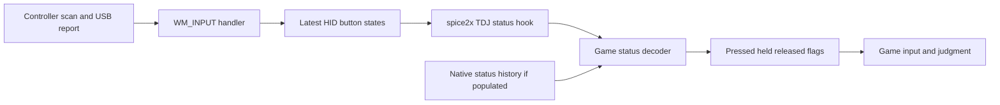

# IIDX 34 TDJ input history and spice2x HID analysis

Analysis date: 2026-10-20. Applies to the supplied IIDX 34 / 010-0916 DLL,
SHA-256 `3755587f44785effe5008f74cfe7dccbdf423ad09feead48e00a90f78a42fe83`.
The user reports current spice2x, a DJ DAO "red lms" controller in HID button
mode, and TDJ / Lightning Model mode. The controller firmware, USB report
descriptor, actual spice2x executable hash and live debounce configuration
were not supplied.

## Findings

The game consumes a sequence-counted key-history buffer in its TDJ board
interface. The examined spice2x TDJ emulation supplies current button states
but leaves that history and its counter zero. This is a specific functional
difference: a brief press already released when the game polls can be recovered
from native-format history, but cannot be recovered from an empty released
snapshot.

This history is not used as a timestamped event queue for judgment in the
inspected path. The game ORs history samples into the current 14 key states,
then produces pressed/held/released flags. Sample position does not become a
judgment-time correction; multiple transitions in one batch can collapse.
Isolated execution of the actual DLL instructions confirms these behaviors.

The evidence does **not** establish that this controller loses ordinary presses,
that a real BIO2 board has lower latency/jitter on this PC, or that changing the
hook improves EX score. It establishes a missing history feature and a
conditional missed-pulse mechanism. Physical board cadence, controller scan
and USB behavior, and real game polling must be measured separately.

The [cadence follow-up](iidx34-input-cadence-analysis.md) now traces the
regular main loop and its native TDJ 120 Hz configuration. It establishes
one input update per frame, nominally 8.333 ms at that rate, while leaving
actual runtime intervals unmeasured.

## Source versions and scope

The source checkout is `reference/spice2x`, remote
`https://github.com/spice2x/spice2x.github.io.git`.
Its worktree remained at `7aba7da3b67f3e4c8b0e950f306bd044d69fa494`.
After fetching, `origin/main` was
`c83496776e4dfa06f286e483d21fd269c331505c` (2026-10-12).
The relevant `games/iidx`, `rawinput`, `cfg/api.cpp` and `cfg/button.h` files
have no differences between that worktree, tag `26-10-03`
(`ed0ccdd6e36671267c622c6442267bbbe1caf7e4`) and the fetched main.
This pins source evidence without treating the user's word "latest" as an
executable fingerprint.

Primary source locations, pinned to the fetched commit:

- [TDJ status hook](https://github.com/spice2x/spice2x.github.io/blob/c83496776e4dfa06f286e483d21fd269c331505c/src/spice2x/games/iidx/bi2x_hook.cpp#L135-L246).
- [Raw Input HID report processing](https://github.com/spice2x/spice2x.github.io/blob/c83496776e4dfa06f286e483d21fd269c331505c/src/spice2x/rawinput/rawinput.cpp#L1593-L1900).
- [Button state and debounce](https://github.com/spice2x/spice2x.github.io/blob/c83496776e4dfa06f286e483d21fd269c331505c/src/spice2x/cfg/api.cpp#L195-L510).
- [Zero debounce defaults](https://github.com/spice2x/spice2x.github.io/blob/c83496776e4dfa06f286e483d21fd269c331505c/src/spice2x/cfg/button.h#L58-L59).
- [IIDX I/O setup](https://github.com/spice2x/spice2x.github.io/blob/c83496776e4dfa06f286e483d21fd269c331505c/src/spice2x/games/iidx/iidx.cpp#L350-L424).

IIDX has multiple I/O paths. The inspected DLL imports
`AIO_IOB2_BI2X_TDJ::GetDeviceStatus` from `libaio-iob2_video.dll`.
Its consumer's RTTI name is `IO::AIOBI2ADeviceTDJImpl`, despite the imported
BI2X name. Do not infer the physical board or firmware solely from these names.
The alternate serial BI2A/BI2X paths are not interchangeable with this TDJ path.
Spice's TDJ creation log identifies its emulation as active; a live log would
confirm the actual runtime selection.

## HID to game data flow



The HID handler parses every report in a `WM_INPUT`, overwriting stored button
states as it goes. It records `input_time` from a host performance clock during
handling, before iterating reports. This is not an observed switch-contact
timestamp. Reports within that message share this time. Microsoft's
[RAWHID definition](https://learn.microsoft.com/en-us/windows/win32/api/winuser/ns-winuser-rawhid)
specifies report count, report size and report bytes; device-specific bytes
could encode additional information, but this button path does not extract a
controller timestamp.

`GameAPI::Buttons::getState` returns a pressed/released state, with optional
debounce. Its last-transition times are not passed to IIDX as judgment events.
For the fake TDJ node, the hook clears all 202 status bytes, then writes
`0xFF` into bytes 27–40 for pressed keys. It does not populate byte 3 or bytes
136–201. Thus an observed down then up can disappear before a game poll;
parsing every HID report does not itself preserve every edge for the game.

The hook's `devices_flush_output()` call is output flushing; its nearby
"flush raw input" comment is not evidence of an input event queue.

### Separate debounce observation

In the examined HID implementation, a release updates the field named
`button_down`, and a press updates `button_up`. Keyboard handling uses the
opposite, conventional association. The shared debounce code consumes those
names as up/down times. This is a potential nonzero-debounce inconsistency,
not evidence of a stock judgment timestamp mechanism. Both configured defaults
are zero, and the user's live settings are unknown. Do not attribute an effect
to this discrepancy without reproducing it with the actual configuration.

## Native ABI and interpretation

Addresses below are RVAs relative to preferred image base `0x180000000`.
Object and status field offsets are decimal. The import address is an IAT slot.

| Role | RVA or layout |
|---|---|
| `GetDeviceStatus` import slot | `0xc675d0` |
| Controller refresh and status fetch | `0xa52240` |
| TDJ implementation vtable | `0xd9bcc8` |
| TDJ decoder, vtable slot 3 | `0xa54980` |
| Press query, slot 10 | `0xa53a10` |
| Held query, slot 11 | `0xa53930` |
| Release query, slot 12 | `0xa53950` |
| Auto-repeat query, slot 13 | `0xa53970` |
| Game input poll | `0xa67d70` |
| Judgment frame-difference helper | `0x80dc80` |
| Frame-difference to milliseconds | `0x80c130` |
| Controller subobject | TDJ object +24 |
| Status buffer | controller +48 = TDJ object +72 |
| New sample counter | status +3 = object +75 |
| P1 keys 1–7 | status +27 through +33 |
| P2 keys 1–7 | status +34 through +40 |
| History | status +136 through +201: 33 pairs of bytes |
| Prior counter / decoded history length | object +316 / +320 |
| Per-button counters | object +328, stride 40; keys use indices 12–25 |
| Repeat-suppression threshold / mode | object +3524 / +3528 |

`0xa52240` calls the imported getter with controller+48.
`0xa54980` refreshes that controller, saves previous per-button counters,
reads current keys as **nonzero bytes**, and computes how much history to scan.
The `0xFF` key value is therefore a true state here, not eight separately
timed key events.

Counter handling, reconstructed from instructions at `0xa54a91`:

```text
n = int(status[3]) - int(previous_counter)
if n < -128:
    n += 256
else if n < 0:
    n = 33
n = clamp(n, 0, 33)
```

For each of the first `n` pairs, bits 0–6 of byte 0 are ORed into P1's
seven states and bits 0–6 of byte 1 into P2's. The loop starts at
`0xa54ac9`; the prior counter is updated at `0xa54b84`.
The history's physical sample period and chronological direction are not
established by this consumer. **33 samples must not be reported as 33 ms.**

Each resulting true state increments a per-key held-update counter; false
resets it to zero. The query functions expose:

- Held: current counter is nonzero.
- Pressed: current counter is one, subject to native repeat suppression.
- Released: previous counter is greater than current.
- Auto-repeat: also generates repeats after the held counter reaches 36,
  then every 24 increments. These are update counts, not clock timestamps.

The main game poll `0xa67d70` calls those virtual queries and builds four
button bitmasks. No history sample position or device timestamp accompanies
these flags. The later judgment helper subtracts integer chart-frame
positions and converts the difference to milliseconds. That arithmetic alone
would not prove the absence of earlier timestamp conversion; the traced
status-to-flags reduction is the additional evidence here.

## Verification with actual instructions

Run the committed read-only harness:

```powershell
analysis/iidx34-tools/Scripts/python.exe scripts/verify-iidx34-input.py `
  'C:\Users\BeatMania IIDX LM\Downloads\bm2dx.dll'
```

Dependencies: `pefile`, `unicorn` (verified with Unicorn 2.1.4).
The script verifies the complete file hash, maps the decoder/query code into
an isolated x86-64 emulator, and supplies synthetic objects and status buffers.
It executes `0xa54980`, `0xa53a10`, `0xa53930` and `0xa53950`.
Device refresh and the compiler's security-cookie check use return stubs;
native repeat suppression is zeroed to isolate status decoding. The DLL is
not loaded into Windows, and neither the file nor the running game is patched.

Verified outcomes:

| Controlled input | Native decoder result |
|---|---|
| All released, counter zero, empty history | No press |
| Current key released, one new history sample has key down | Press and held |
| Same counter and history supplied again | History not replayed; release |
| Each of 14 individual history key bits | Correct key query only |
| Key down at buffer position 0, 16 or 32, count 33 | Same pressed state |
| Down/up/down in three samples | One pressed state, not two events |
| Previously held key, current released, history contains down | Remains held for this update |
| Counter 255 to 0 | One new sample consumed |
| Counter delta 100 | History scan capped at 33 |

These results validate the binary interpretation, not USB behavior, real
board history contents, the application's actual poll rate or score changes.
The supplied companion `libaio-iob2_video.dll` and physical board were not
available for verifying how native history is produced.

## Consequences for stability and possible changes

There are three separate questions:

1. **Can a complete press disappear?** Yes, conditionally: if HID processing
   sees down and up before the next status read, the latest-state path can
   present only released. The native-format history can preserve that press
   if it contains the down sample and a corresponding counter increment.
2. **Does native history undo late delivery?** Not in this decoder. It reports
   activity during the current update, with no sample-time correction.
   History can also extend a held state or combine multiple presses.
3. **Is the user's input measurably worse?** Unknown. Long enough presses may
   be observed by both paths; timing spread can originate in controller
   scanning, debounce, USB delivery, host scheduling and game polling.

For illustration only, periodic observation every `T` milliseconds adds a
phase-dependent wait in `[0, T)` even with immediate report delivery.
The [caller/pacing follow-up](iidx34-input-cadence-analysis.md) establishes
that native TDJ gameplay targets a frame-coupled 120 Hz input update,
nominally about 8.33 ms. This is not a measured delay of spice2x, and the
native-history path feeds the same game update. A constant offset can
compensate a mean delay; it cannot remove variable delay or recover an
omitted press.

A plausible compatibility experiment would retain HID transitions before
overwriting states, then expose history consistently with the native status
counter. Both the counter and buffer must be maintained; copying only current
states into history cannot recover an already overwritten edge.
The native producer's sampling/ordering contract and polling cadence should
be established before treating that experiment as faithful board emulation.
Any prototype must test release behavior, rapid repeats and long notes, not
only isolated key downs.

Host timestamps would help measure arrival and scheduling jitter, but adding
them to a queue does not make this game use them for scoring. Backdating
judgment would require a different game-facing path and a validated mapping
between clocks; it is not an existing benefit proven for BIO2 by this analysis.
Switching to a physical board alone has no demonstrated benefit here.

## Measurement needed for a controller-specific conclusion

Record the actual spice2x executable/version, controller firmware and USB
descriptor/report interval, key debounce settings, TDJ mode, and actual
input-poll intervals. Preserve these with results.

Instrument four boundaries with one host performance clock: HID report
arrival/processing, retained transition state, TDJ status read, and the game's
pressed/released bitmask. Capture all 14 keys as a coherent sample when
comparing chords. Logging should use a preallocated memory buffer and export
outside gameplay to avoid measuring synchronous logging stalls.

For a repeated, controlled input pattern, measure:

- Missing and duplicate presses, plus release/long-note behavior.
- Report-to-game-detection median, p95, p99, maximum, and interval spread.
- Transitions processed completely between consecutive game status reads.
- Game poll gaps and correlation with late detections.

Compare unchanged spice2x with a history-preserving prototype under the same
controller, firmware, game settings and input pattern. Host measurements
exclude switch-to-USB time; a physical contact reference or suitable hardware
capture is needed for total physical latency and a genuine BIO2 comparison.
In-game FAST/SLOW or EX-score comparisons alone do not isolate these stages.

No input modification is included in this investigation. The proven next
engineering target is preserving and measuring input history, with any score
or latency benefit evaluated rather than assumed.
